# 📊 Customer Intelligence & Business Decision Support

### Python Automation • CRM Customer Identification • Business Intelligence • Operational Efficiency

### 💡 Project Overview

Transforming distributor purchasing records into actionable customer intelligence through **Python automation, CRM reconciliation, historical performance analysis, and business intelligence reporting**—improving customer identification, streamlining operational workflows, supporting data-driven business decisions, and creating opportunities for more targeted sales outreach and revenue growth.

### 📊 Animated Business Intelligence Dashboard

---

## 🎯 The Business Problem

Distributor customer records needed to be reconciled with existing CRM accounts to identify purchasing activity and maintain accurate customer information.

New distributor files arrived regularly while older unresolved records created a historical backlog.

Leadership needed to understand:

- Which customer records could be identified efficiently.
- Where manual research produced meaningful results.
- How employee time could be allocated more effectively.
- Which portions of the customer identification process offered opportunities for automation.
- How customer identification could support business decisions, sales outreach, and revenue opportunities.

**The objective was to improve customer identification while reducing unnecessary research and creating capacity for higher-value analytical work.**

---

## 📈 Project Results at a Glance

| Performance Metric | Result |
|---|---:|
| Distributor workbooks consolidated | **17** |
| Customer records analyzed | **877** |
| Successfully identified customer records | **648** |
| Overall customer identification rate | **73.9%** |
| Quick customer identifications | **302 (34.4%)** |
| Research-assisted customer identifications | **346 (39.5%)** |
| Records from five largest distributors | **82.1%** |

### 🚀 Customer Identification Improvement

# Approximately 60% → 80–90%

Improved customer identification through Python-assisted fuzzy matching, data standardization, and manual research.

This broader operational improvement is separate from the 73.9% customer identification rate observed in the June 2026 analysis sample.

**Business significance:** More distributor customers could be associated with existing CRM accounts, improving visibility into customer purchasing activity.

---

## 🐍 Technical Development & Analytical Workflow

### 1. Python & Pandas — Data Processing

Developed a Python workflow using Pandas and Jupyter Notebook to:

- Consolidate customer identification results from distributor workbooks.
- Clean and standardize customer information.
- Organize completed customer identification outcomes.
- Group records by identification-confidence scores.
- Calculate customer identification performance across distributors and worksheet types.
- Prepare structured datasets for further analysis.

This reduced repetitive data preparation and made historical customer identification results easier to analyze.

### 2. Microsoft Excel — Operational Analysis

Used advanced Excel, PivotTables, and Power Pivot to evaluate:

- Customer identification outcomes.
- Distributor record volumes.
- Identification-confidence score ranges.
- Quick-identification versus manual-research performance.
- Differences across worksheet categories.
- Cumulative workload coverage.

### 3. DAX — Performance Measurement

Created measures to calculate:

- Quick Match %
- Manual Match %
- Total Match %
- Create New %
- Not Mapped %
- Cumulative Records Processed
- Cumulative Successful Matches
- Cumulative Matching Success Rate

These measures helped quantify the relationship between research workload and successful customer identification.

### 4. Power BI — Business Intelligence Reporting

Developed reporting views covering:

- Executive performance KPIs.
- Distributor customer identification performance.
- Worksheet-level analysis.
- Confidence-score performance.
- Cumulative workload coverage.
- Research-efficiency tradeoffs.

The dashboard translated historical customer identification results into information leadership could use to evaluate operational decisions.

---

## 🎯 Customer Identification & Research Efficiency

One of the project's most important findings was that different identification-confidence ranges required different levels of employee research.

### Cumulative Customer Identification Performance

| Confidence Scores | Workload Coverage | Successful Identifications | Identification Rate |
|---|---:|---:|---:|
| **50–80** | 38.1% | 309 | **92.5%** |
| **40–80** | 53.6% | 398 | **84.7%** |
| **30–80** | 83.4% | 555 | **75.9%** |
| **20–80** | 98.4% | 638 | **73.9%** |
| **0–80** | 100.0% | 648 | **73.9%** |

### Key Finding

**38.1% of the analyzed workload produced 309 successful customer identifications at a 92.5% identification rate.**

Expanding coverage through the 40–80 confidence-score range increased successful customer identifications to 398 while maintaining an 84.7% identification rate.

This demonstrated how historical results could inform decisions about the relationship between:

**Customer Identification + Research Effort + Employee Capacity**

Lower-confidence records were not necessarily unproductive. However, they generally required more manual investigation.

The analysis helped distinguish records suitable for quicker processing from those requiring deeper research.

---

## 📦 Distributor & Worksheet Intelligence

The five highest-volume distributors accounted for **720 of 877 analyzed records (82.1%)**.

This finding helped explain where incoming workload was concentrated and supported capacity planning across distributor sources.

### Worksheet Performance

| Worksheet Category | Records | Customer Identification Rate |
|---|---:|---:|
| Default D365 | 427 | 69.8% |
| Historic | 180 | 76.1% |
| In D365 | 270 | **78.9%** |

Worksheet categories also showed differences in quick-identification and manual-research requirements.

Combining distributor information, worksheet categories, confidence scores, and historical outcomes created a more complete understanding of the customer identification process.

---

## 💼 From Customer Identification to Revenue Opportunities

Customer identification is more than a data-cleaning exercise.

Every successfully identified customer improves the organization's ability to understand purchasing activity and support downstream business functions.

### The Business Value Chain

**Incoming Distributor Purchasing Data**

↓

**Python Automation & Customer Identification**

↓

**More Customers Linked to Dynamics 365 CRM**

↓

**Improved Customer Purchasing Visibility**

↓

**More Actionable Sales & Marketing Outreach**

↓

**Potential Repeat Purchases, Customer Retention & Revenue Growth**

### Business Intelligence Impact

**Sales:** More identifiable customers create opportunities for targeted follow-ups and additional purchases.

**Marketing:** More complete customer information can support more relevant outreach campaigns.

**Management:** Better customer visibility supports operational decisions, resource allocation, and reporting.

**Finance & Reporting:** Cleaner customer records can improve the quality of customer activity analysis.

**Operations:** Reduced repetitive research creates capacity for additional customer identification and data-quality work.

### Return on Investment

The project demonstrated two distinct sources of potential business value:

**Operational ROI:** More efficient processing, reduced repetitive work, and improved employee capacity.

**Commercial ROI:** Better customer identification creates opportunities for Sales and Marketing to reach previously unidentified customers.

Additional revenue was not directly measured or attributed to this project.

---

## ⏱️ Operational Efficiency & Backlog Reduction

The customer identification process involved recurring monthly distributor data and a historical backlog.

Improving the efficiency of incoming record processing could help prevent additional backlog while creating capacity to investigate older customer records.

### Operational Improvements

- Reduced repetitive customer research.
- Supported more efficient handling of incoming records.
- Identified opportunities for future automation.
- Improved visibility into research requirements.
- Supported historical backlog reduction.
- Created additional capacity for business intelligence and data-quality analysis.

### Annualized Labor Cost Context

# $114,000

**Equivalent to two $57,000 annual base salaries.**

This figure illustrates the annualized base-salary cost associated with two full-time roles. It is not a verified calculation of net savings attributable to the project.

The broader value was improving how available employee time could be used while strengthening customer information for downstream business functions.

---

## 🧠 Business Decisions Supported

The analysis helped address several leadership questions:

| Business Question | Analytical Contribution |
|---|---|
| Where can customer records be processed efficiently? | Confidence-score and quick-identification analysis |
| Where does manual research add value? | Research-assisted identification performance by score range |
| How much additional coverage is gained through deeper research? | Cumulative workload and identification analysis |
| Where is incoming workload concentrated? | Distributor record-volume analysis |
| How do different record categories behave? | Worksheet performance analysis |
| Where might automation reduce manual intervention? | Historical outcome and confidence-score analysis |
| How can findings be communicated to leadership? | Power BI dashboards and executive KPIs |

**The central achievement was converting historical operational data into measurable insights that could guide future workflow decisions.**

---

## 🛠️ Technologies & Skills

| Technology | Application |
|---|---|
| Python | Data processing and automation |
| Pandas | Data cleaning, consolidation, and aggregation |
| Jupyter Notebook | Python development and analysis |
| Microsoft Excel | Advanced analysis and reporting |
| PivotTables | Performance segmentation |
| Power Pivot | Analytical data modeling |
| DAX | KPI and cumulative-performance measures |
| Power BI | Interactive dashboards and decision support |
| Dynamics 365 CRM | Customer identification and reconciliation |

**Additional Skills:** Customer Analytics · Entity Resolution · Data Quality · Business Intelligence · KPI Development · Process Improvement · Operational Analytics · Workflow Optimization · Data Visualization

---

## 🔒 Data Confidentiality

This portfolio project presents analytical methods, aggregated performance results, and business insights without publishing proprietary customer-level information.

Real distributor customer records, confidential CRM data, and internal company datasets are not included.

Any illustrative datasets used for demonstrations should be identified as synthetic.

---

## ✅ Project Outcome

This project transformed historical distributor customer identification results into a structured business intelligence framework using **Python, Pandas, Excel, Power Pivot, DAX, and Power BI**.

The analysis identified where customer identification performance was strongest, where manual research contributed substantial value, and how different workload segments could inform operational planning.

More importantly, it demonstrated how better customer identification supports a larger business objective:

**Efficient Customer Identification → Better CRM Data → Improved Business Decisions → More Sales Outreach Opportunities → Potential Revenue Growth**

The project connected technical analytics to operational efficiency, customer intelligence, and downstream business value.

---

*Analysis based on June 2026 customer identification results. Commercial revenue benefits are potential downstream opportunities rather than directly measured outcomes.*
